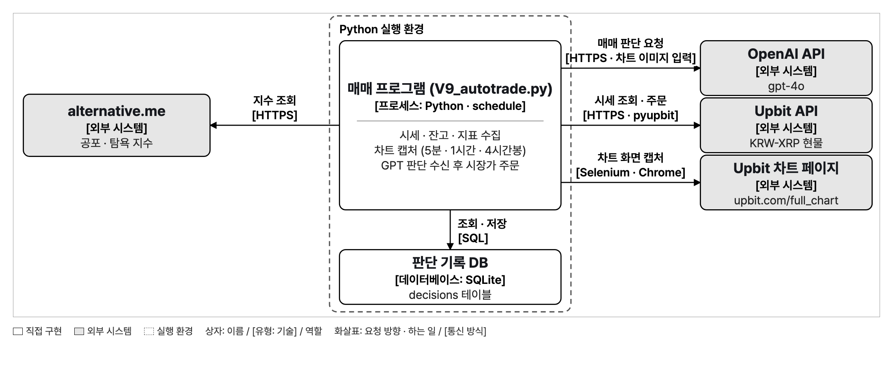

# VALKYR

GPT-4o가 차트와 시장 정보를 보고 매매를 판단하는 Upbit 현물 자동매매 프로그램입니다. (1세대)

## 구현 내용

- 대상: Upbit `KRW-XRP` 현물 한 종목
- Selenium으로 업비트 차트를 열어 스크린샷 생성
- 뉴스, 공포·탐욕 지수, 코드에서 계산한 RSI · 볼린저 밴드를 차트 이미지와 함께 GPT-4o에 전달
- GPT-4o가 `buy` / `sell` / `hold`와 거래 비율을 JSON으로 반환 → 코드가 시장가 주문 실행
- 초기 버전: 거래 후 회고를 만들어 패턴 DB에 저장하고 다음 판단에 다시 입력
- 이후 버전: 회고 구조를 빼고 목표가 · 손절가와 계획을 `decision_targets`에 저장, Streamlit 대시보드 분리

## 시스템 구조

그림은 `Ver_9_Origin/V9_autotrade.py` 기준입니다.

| 구간 | 구성 |
| --- | --- |
| 실행 | `schedule`로 정해진 시각마다 `make_decision_and_execute` 실행 |
| 입력 수집 | `pyupbit`로 시세 · 호가 · 잔고 조회, RSI · 볼린저 밴드 계산, Selenium(Chrome)으로 업비트 차트를 5분 · 1시간 · 4시간봉으로 바꿔 가며 캡처 |
| AI 호출 | 차트 이미지(base64)와 지표, 공포 · 탐욕 지수를 `gpt-4o`에 전달 |
| 주문 · 저장 | `buy_market_order` / `sell_market_order` 시장가 주문, 판단 내용은 SQLite `decisions` 테이블에 기록 |

## 폴더 구성

| 폴더 | 내용 |
|---|---|
| `Ver_3.0.0/` | 현재 남아 있는 가장 이른 버전입니다. GPT-4o 판단, 차트 이미지 입력, 거래 회고와 패턴 DB가 한 파일 안에 들어 있습니다. 폴더 안의 3.0.0 → 3.0.1 → 3.0.1_6 → 3.0.2를 통해 프롬프트가 바뀌는 과정도 볼 수 있습니다. |
| `Ver_3.6_Adaptive/` | 구조가 크게 바뀐 시점입니다. 회고·패턴 DB를 제거하고 매매 코드와 Streamlit 대시보드를 분리했습니다. `decision_targets`를 추가해 목표가, 손절가, 예상 시각, 신뢰도 등을 저장합니다. 다만 이 버전에서 코드는 목표가를 직접 감시하지 않고 프롬프트 입력으로 사용합니다. |
| `Ver_9_Origin/` | 마지막 실행 코드입니다. 3.6 계열 구조를 유지하면서 `decision_targets`를 다시 제거한 형태입니다. |
| `Ver_10/` | 실행 코드는 없고 `Concept.txt`만 남아 있습니다. GPT가 만든 1~3차 목표가와 손절가를 프로그램이 실시간으로 감시한다는 설계이며, 이 아이디어가 다음 세대 ARGOS에서 구현됩니다. |

중간의 여러 버전은 3.0 또는 3.6 구조를 기반으로 프롬프트, 스케줄, 최소 주문액 등을 조정한 변형이라 이 저장소에는 대표 버전만 남겼습니다.

## 사용 기술

- Python
- Upbit / `pyupbit`
- OpenAI API / `gpt-4o`
- Selenium
- SQLite
- Streamlit
- SerpApi
- Fear & Greed Index
- RSI, Bollinger Bands 등 기술 지표

## 참고

- 선물, 레버리지, 공매도는 사용하지 않음
- 3.6 버전의 목표가 · 손절가는 코드가 직접 감시하지 않고 프롬프트 입력으로만 사용
