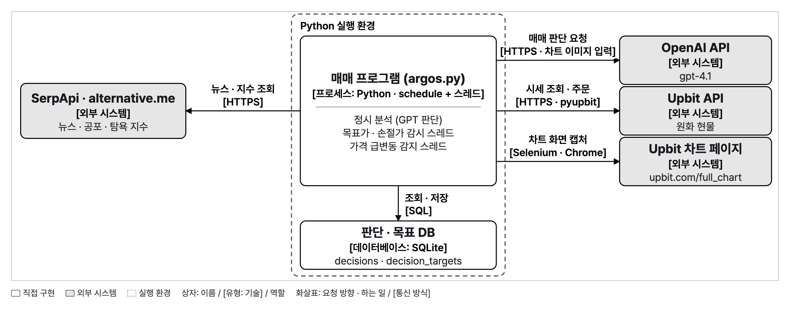

# ARGOS

GPT가 만든 진입가 · 목표가 · 손절가를 코드가 실시간으로 감시해 주문하는 Upbit 현물 자동매매 프로그램입니다. (2세대)

## 구현 내용

- GPT가 진입가, 목표가, 손절가와 거래 계획을 생성 → 코드가 `decision_targets`에 저장
- 별도 감시 스레드가 현재 가격을 확인하다 지정 가격에 도달하면 GPT를 다시 호출하지 않고 주문 실행
- 급격한 가격 변동이 감지되면 재분석하는 경로 추가
- `_V7_short`부터 5분 · 15분 · 1시간봉 중심의 단기 매매, MACD · ADX/DMI 계산
- `_V9`부터 단일 진입가 · 목표가 · 손절가 구조로 단순화
- `_V6`부터 모델을 `gpt-4o`에서 `gpt-4.1`로 변경

## 시스템 구조

그림은 `_V10/argos.py` 기준입니다.

| 구간 | 구성 |
| --- | --- |
| 실행 | `schedule`로 정시 분석을 실행하고, 목표가 · 손절가 감시와 가격 급변동 감지는 별도 스레드로 실행 |
| 입력 수집 | `pyupbit` 시세 · 호가 · 잔고, MACD · ADX/DMI 등 지표 계산, Selenium 차트 캡처(5분 · 15분 · 1시간봉), SerpApi 뉴스, 공포 · 탐욕 지수 |
| AI 호출 | `gpt-4.1`이 진입가 · 목표가 · 손절가를 생성 |
| 주문 · 저장 | SQLite `decisions`, `decision_targets` 테이블에 기록. 감시 스레드가 가격 도달 시 GPT 재호출 없이 주문 |
| 대시보드 | `argos_dashboard_v10.py` (Streamlit)가 같은 SQLite 파일을 읽어 표시 |

## 폴더 구성

| 폴더 | 내용 |
|---|---|
| `_V1/` | ARGOS의 첫 버전입니다. VALKYR `Ver_10/Concept.txt`의 다단계 목표가·손절가 감시 설계를 실제 코드로 구현했습니다. 매매 코드, Streamlit 대시보드, `Concept.txt`를 함께 보존했습니다. |
| `_V8_short/` | `_V7_short`부터 시작된 단기 매매 흐름을 보여 주는 보존본입니다. 5분·15분·1시간봉을 중심으로 보고 MACD, ADX/DMI 등을 계산하는 구조를 이어받았고, `argos_8_CoT.py`에서는 단계적 사고를 명시한 프롬프트와 예측 결과 평가를 추가했습니다. 가격 감시 간격도 더 짧게 조정됐습니다. |
| `_V10/` | XRP용 마지막 버전입니다. `_V9`에서 단일 진입가·목표가·손절가 구조로 단순화된 흐름을 이어받고, 레짐 판별과 여러 지표의 합류를 강조한 `ARGOS Quantitative Trading System v3.0` 영어 프롬프트와 4단계 CoT를 사용합니다. |

중간 버전에서는 프롬프트의 성격, 분석 주기, 대상 종목 등을 계속 조정했습니다. `_V6`부터 모델이 `gpt-4o`에서 `gpt-4.1`로 바뀌었고, ETH와 BTC를 대상으로 한 변형도 있었습니다.

## 사용 기술

- Python
- Upbit / `pyupbit`
- OpenAI API / `gpt-4o`, `gpt-4.1`
- Selenium
- SQLite
- Streamlit
- SerpApi
- Fear & Greed Index
- MACD, ADX/DMI 등 기술 지표
- Python 스레드를 이용한 가격 감시

## 참고

- 폴더 이름의 `short`는 공매도가 아니라 단기 매매를 뜻함 (Upbit 현물)
