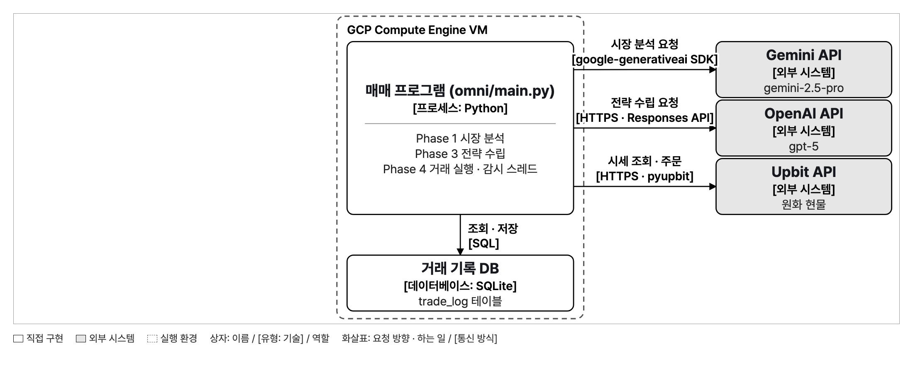

# OMNI

XRP 전용 OODA-R 구조에서 시작해 여러 코인을 단계별로 분석하는 AI 파이프라인으로 확장한 Upbit 현물 자동매매 프로그램입니다. (3세대)

## 구현 내용

- 초기 XRP 버전: `OBSERVE → ORIENT & DECIDE → ACT → REFLECT` 흐름의 OODA-R 구조, 거래 회고와 교훈을 다음 판단에 다시 입력
- 이후 버전: 여러 코인을 먼저 훑어 후보를 고른 뒤 심층 분석, 전략 수립, 거래 실행을 Phase로 분리
- `OMNI-fractal`: Hurst 지수를 이용한 프랙탈 차원과 과거 패턴 유사도 분석 추가
- V14: Phase 1은 Gemini 2.5 Pro, 전략 수립은 GPT-5가 담당하는 3단계 구조, 2-Target 분할 익절
- AI 구성: `gpt-4.1` 단독 → GPT-5 단독 → Gemini와 GPT-5 역할 분담

## 시스템 구조

그림은 `OMNI/omni/` (V14) 기준입니다.

| 구간 | 구성 |
| --- | --- |
| 실행 | `main.py`가 Phase 1(시장 분석) → Phase 3(전략 수립) → Phase 4(거래 실행)를 반복 |
| AI 호출 | Phase 1은 `gemini-2.5-pro`(`google-generativeai`), Phase 3은 `gpt-5`(OpenAI Responses API) |
| 거래소 | `pyupbit`로 시세 조회와 주문, 거래 중에는 감시 스레드가 가격을 확인 |
| 저장 | SQLite `logs/trade_history.db`의 `trade_log` 테이블 |
| 대시보드 | `dashboard/streamlit_app.py` (Streamlit)가 같은 DB를 읽어 표시 |

## 폴더 구성

| 폴더 | 시점 | 내용 |
|---|---|---|
| `OMNI-XRP/` | 2025-07 | XRP 전용 OODA-R 버전입니다. `gpt-4.1`을 사용하며, 거래 회고와 교훈을 다음 판단에 다시 넣습니다. v8에서는 설정과 기능 구획을 더 명확히 나누고 리샘플링 검증과 위꼬리 방어 로직 등을 추가했습니다. |
| `OMNI-2025-09-03/` | 2025-09-03 | 여러 코인을 다루는 모듈 구조로 바뀐 시점입니다. GPT-5 기반 5-Phase 구조이며 `Principles.md`와 최근 거래를 읽고, 거래가 끝나면 원칙을 다시 작성하는 회고 학습이 활성화돼 있습니다. |
| `OMNI-fractal/` | 2025-09 ~ 2025-10 | GPT-5 기반 5-Phase 구조에 Hurst 지수를 이용한 프랙탈 차원과 과거 패턴 유사도 분석을 추가했습니다. 이 버전에서는 회고 학습 기능이 주석 처리돼 사실상 꺼져 있습니다. |
| `OMNI/` | 2025-10 이후 | V14 계열입니다. 5-Phase에서 Phase 2를 제거한 3단계 실행 구조로 바뀌었고, Gemini 2.5 Pro와 GPT-5를 함께 사용합니다. 회고 모듈은 제거됐으며 2-Target 분할 익절 구조가 추가됐습니다. |

## 사용 기술

- Python
- Upbit / `pyupbit`
- OpenAI API / `gpt-4.1`, `gpt-5`
- Google Gemini / `gemini-2.5-pro`
- SQLite
- Streamlit
- 다중 시간대 기술 지표
- Hurst 지수 기반 프랙탈 분석
- GCP VM

## 참고

- OODA 구조는 `OMNI-XRP`에만 있고 후기 `OMNI/`는 Phase 기반 구조
- 후기 코드에는 뉴스 수집 구현이 없음
