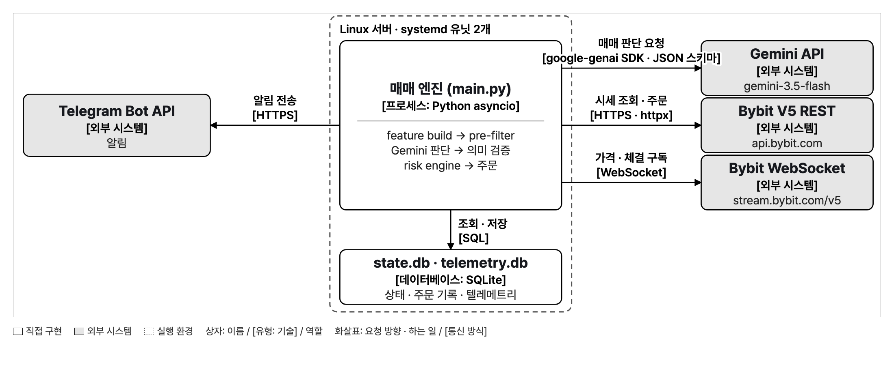

# METIS

Bybit USDT 무기한 선물에서 AI의 역할을 여러 구조로 구현한 자동매매 프로그램입니다. (4세대)

## 구현 내용

- v1 (`metis-f/`): 코드가 시장 레짐과 진입 신호를 만들고 Gemini는 진입을 `PASS` / `REJECT`로만 판단 (BTCUSDT)
- v2 · v3: AI가 방향, 레버리지, 손절가와 목표가를 결정 → [`metis-ai-trader`](https://github.com/deltaomega02/metis-ai-trader)에 정리
- v4 (`metis-v5/`): 라이브 판단에 AI를 쓰지 않는 BTC 현물 추세추종과 현물+무기한 선물 펀딩 캐리 전략, 백테스트 코드 포함
- v5 (`metis/v5/`): feature build → pre-filter → Gemini → semantic validate → risk engine 순으로 처리, 코드의 리스크 엔진이 AI의 `ENTER` 결정을 거부 가능
- v6: 4시간봉 기반 다중 코인 돌파 규칙 → [`metis-rule-trader`](https://github.com/deltaomega02/metis-rule-trader)에 정리

## 시스템 구조

그림은 `metis/v5/code/` 기준입니다.

| 구간 | 구성 |
| --- | --- |
| 실행 | systemd 유닛 2개 (`metis-v5`: 매매 엔진, `metis-v5-dashboard`: 대시보드). `Restart=on-failure` |
| 엔진 | asyncio 기반. feature build → pre-filter → Gemini → semantic validate → risk engine 순으로 처리 |
| AI 호출 | `google-genai` SDK로 `gemini-3.5-flash` 호출, 응답 스키마를 지정해 JSON으로 수신 |
| 거래소 | Bybit V5 REST(`httpx.AsyncClient`)와 WebSocket(`websockets`, public · private 스트림) |
| 저장 | SQLite `state.db`, `telemetry.db` |
| 대시보드 | 표준 라이브러리 `http.server` 기반, DB를 읽기 전용(`mode=ro`)으로 조회 |

## 폴더 구성

| 폴더 | 내용 |
|---|---|
| `metis-f/` | 첫 AI 버전입니다. BTCUSDT를 대상으로 코드가 진입 신호를 만들고 Gemini는 해당 진입을 통과시킬지 거부할지만 판단합니다. |
| `metis-v5/` | 코드상 METIS v4 계열입니다. 라이브 판단에서 AI를 뺀 첫 버전으로, BTC 현물 추세추종과 현물+무기한 선물 펀딩 캐리 전략을 실험했습니다. 백테스트 코드와 `docs/findings.md`도 함께 남아 있습니다. |
| `metis/v5/` | Gemini를 다시 매매 판단에 넣은 버전입니다. feature build → pre-filter → Gemini → semantic validate → risk engine 순으로 처리하며, 마지막 코드 리스크 엔진이 AI의 `ENTER` 결정을 거부할 수 있습니다. |

v2와 v3는 이 폴더에 중복 보존하지 않았습니다. 해당 계열은 별도 공개 저장소 [`metis-ai-trader`](https://github.com/deltaomega02/metis-ai-trader)에 정리돼 있습니다.

규칙 기반 v6 역시 이 폴더에는 넣지 않았으며 [`metis-rule-trader`](https://github.com/deltaomega02/metis-rule-trader)에서 확인할 수 있습니다.

v7은 완성된 실행 버전으로 보기 어려운 실험 분기라 포함하지 않았습니다.

## 사용 기술

- Python
- Bybit API
- Bybit USDT 무기한 선물
- Google Gemini
- 기술 지표와 코드 기반 신호 생성
- 백테스트 스크립트
- Streamlit
- systemd
- GCP VM

## 참고

- `metis-v5/` 폴더의 추세 봇은 코드상 METIS v4로 표시됨 (폴더 이름과 버전 번호가 다름)
- v7은 완성된 실행 버전이 아니라 포함하지 않음
