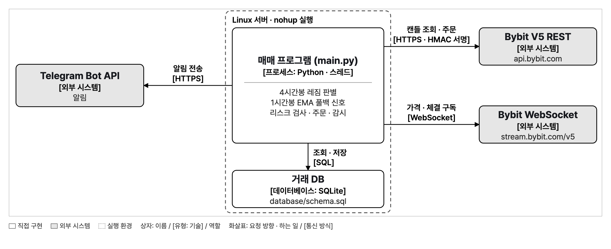

# HERMES

지표와 조건을 코드에 명시한 규칙 기반 추세 전략으로 매매하는 Bybit 선물 자동매매 프로그램입니다. (5세대)

## 구현 내용

- 매매 판단 경로에 AI 없음
- 4시간봉에서 시장 레짐 확인 → `TRENDING` 구간에서 1시간봉 EMA 추세 풀백 신호 탐색
- 일봉 방향 필터, ADX, ATR 기반 손절 · 목표가, 트레일링 규칙을 코드로 구현
- 지정가 우선 진입, WebSocket 수신, SQLite 기록
- 그리드서치, 슬리피지 민감도 테스트, Walk-Forward, 몬테카를로 분석 스크립트 작성 (`backtest/`)

## 시스템 구조

그림은 루트의 운영 코드 기준입니다.

| 구간 | 구성 |
| --- | --- |
| 실행 | `nohup python3 -u main.py`로 실행 (`setup.sh`) |
| 엔진 | `RegimeEngine`(4시간봉 레짐) → `SignalEngine`(1시간봉 EMA 풀백) → `RiskManager` → `PositionManager` → 감시 스레드 |
| 거래소 | Bybit V5 REST(HMAC 서명)와 WebSocket(`websocket.WebSocketApp`, public · private 스트림). 대상: BTC · ETH · SOL · XRP USDT 무기한 선물 |
| 저장 · 알림 | SQLite (`database/schema.sql`), 텔레그램 알림 |

## 폴더 구성

| 경로 | 내용 |
|---|---|
| 루트 | 실제 운영 코드의 최종본입니다. 코드 주석 기준으로 V13.2~V14 계열 변화가 섞여 있습니다. |
| `backtest/` | 대표 백테스트 실행 코드와 데이터 수집·최적화 도구를 보존했습니다. |
| `backtest/results/` | 그리드서치와 장기 검증 등 일부 결과 JSON을 남겼습니다. |
| `backtesting/` | 버전 변화 문서와 대표 결과 리포트를 모았습니다. v2, v5, v9, v10의 변화 과정을 중심으로 확인할 수 있습니다. |

대표적인 흐름은 다음과 같습니다.

- **v2**: 대규모 그리드서치를 통해 이후 전략 실험의 출발점을 만들었습니다.
- **v5**: 트레일링 설정을 다시 최적화하고 슬리피지 민감도를 확인했습니다.
- **v9**: 여러 구성의 스윕과 몬테카를로 검증을 진행하고 EMA 설정을 변경했습니다.
- **v10**: 일봉 EMA 방향 필터를 추가했습니다.
- **V13~V14 운영 코드**: 지정가 우선 진입을 사용하고, 횡보 전략을 다시 시도한 뒤 비활성화한 흔적이 남아 있습니다.

백테스트 폴더의 버전 번호와 운영 시스템의 버전 번호는 서로 정확히 대응하지 않습니다.

## 사용 기술

- Python
- Bybit API / USDT 무기한 선물
- WebSocket
- 기술 지표 기반 규칙 엔진
- 백테스트
- Grid Search
- Walk-Forward 검증
- Monte Carlo 검증
- Optuna
- SQLite
- `nohup` 기반 서버 실행

## 참고

- 백테스트 폴더의 버전 번호와 운영 코드의 버전 번호는 서로 대응하지 않음
- 운영 코드에 Gemini 관련 파일이 남아 있으나 매매 경로에서는 사용하지 않음
- 횡보 전략, 자동 Walk-Forward 최적화는 코드에 있으나 비활성 상태
