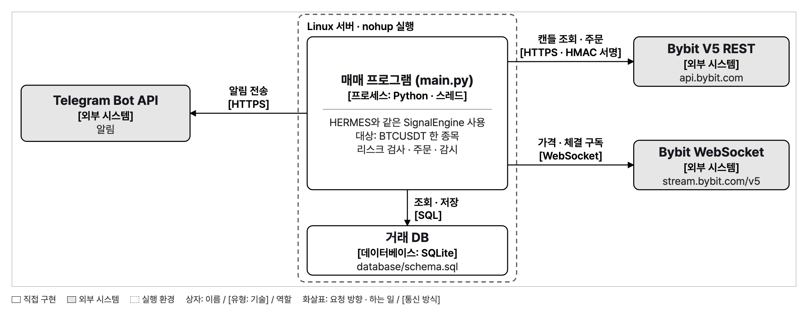

# KAIROS

HERMES의 신호 엔진을 BTC 한 종목으로 줄여 실행하는 Bybit 선물 자동매매 프로그램입니다. (6세대)

## 구현 내용

- 대상 종목을 BTC 하나로, 동시 포지션을 하나로 제한하고 레버리지 상한을 낮춤
- 실행 경로: HERMES와 같은 `SignalEngine` (4시간봉 레짐 + 1시간봉 EMA 풀백)
- BTC 일봉 변동성 돌파 모듈 구현 (`core/breakout_strategy.py`): 전일 변동폭 × K(0.6) 돌파, 다음날 시가 청산, 고정 손절, LONG-only
- 변동성 돌파 · 모멘텀 · 전략 비교 백테스트 스크립트 작성 (`backtest/`)
- AI 관련 설정과 `ai/` 폴더 제거

## 시스템 구조

그림은 루트의 실행 코드 기준입니다.

| 구간 | 구성 |
| --- | --- |
| 실행 | `nohup python3 -u main.py`로 실행 (`setup.sh`) |
| 엔진 | HERMES와 같은 `RegimeEngine` → `SignalEngine` → `RiskManager` → `PositionManager` 경로. 대상은 BTCUSDT 한 종목 |
| 거래소 | Bybit V5 REST(HMAC 서명)와 WebSocket(`websocket.WebSocketApp`) |
| 저장 · 알림 | SQLite (`database/schema.sql`), 텔레그램 알림 |

## 폴더 구성

KAIROS에는 `KAIROS v2` 한 버전만 남아 있습니다. v1 코드는 없습니다.

- 루트의 `main.py`, `config/`, `core/`, `exchange/`, `database/`, `utils/`에는 최종 실행 코드가 있습니다.
- `docs/STRATEGY.md`에는 새로 설계한 변동성 돌파 전략이 정리돼 있습니다.
- `backtest/`에는 KAIROS에서 새로 만든 변동성 돌파·모멘텀·전략 비교 스크립트만 남겼습니다. HERMES와 동일한 백테스트 파일들은 중복해서 보존하지 않았습니다.

HERMES와 비교하면 대상 종목을 BTC 하나로 줄이고, 동시 포지션도 하나로 제한했으며 레버리지 상한을 낮췄습니다. AI 관련 설정과 `ai/` 폴더도 제거했습니다.

## 사용 기술

- Python
- Bybit API / USDT 무기한 선물
- WebSocket
- 기술 지표 기반 규칙 엔진
- 백테스트
- SQLite
- `nohup` 기반 서버 실행

AI 모델은 사용하지 않습니다.

## 참고

- 변동성 돌파 모듈은 구현되어 있으나 `main.py`의 실행 경로에는 연결되어 있지 않음
- `KAIROS v2` 한 버전만 보존 (v1 코드는 없음)
