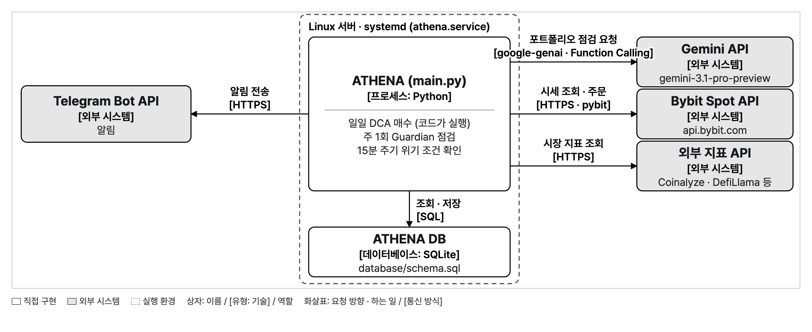

# ATHENA

현물 DCA를 코드가 실행하고 Gemini가 주기적으로 포트폴리오를 점검하는 Bybit 현물 자동매매 프로그램입니다. (7세대)

## 구현 내용

- 매일 정해진 시각에 BTC · ETH · SOL을 DCA로 매수 (AI 호출 없이 코드가 실행), USDT를 현금성 자산으로 보유, 레버리지 미사용
- Gemini Guardian이 매주 한 번 포트폴리오 상태를 점검해 `HOLD` / `DEFENSIVE` / `AGGRESSIVE`와 DCA 배수 제안
- 15분마다 위기 조건을 확인해 필요하면 Guardian을 바로 호출
- 실제 주문량은 코드가 계산. 단일 자산 비중, 최소 USDT 보유량, 한 사이클의 최대 변경 폭, 일일 거래 횟수, 드로다운 제한을 코드에 구현
- Gemini 호출에 반복 횟수, 도구 호출 횟수, 비용, 실행 시간 상한 설정 (Function Calling 기반)

## 시스템 구조

그림은 루트의 최종 코드 기준입니다.

| 구간 | 구성 |
| --- | --- |
| 실행 | systemd 서비스 (`athena.service`, `Restart=always`) |
| DCA | `core/dca_engine.py`가 매일 BTC · ETH · SOL을 매수 (AI 호출 없음) |
| AI 호출 | `google-genai` SDK로 `gemini-3.1-pro-preview` 호출, Function Calling으로 도구(`ai/tools.py`)를 사용하는 Guardian |
| 거래소 | Bybit 현물 (`pybit`) |
| 외부 데이터 | `data_sources/`의 어댑터 9개 (Bybit 시장 데이터, Coinalyze, DefiLlama, ETF 흐름, Fear & Greed, 뉴스, Reddit, yfinance, 사이클 지표) |
| 저장 · 알림 | SQLite (`database/schema.sql`), 텔레그램 알림, Streamlit 대시보드(`dashboard.py`) |

## 폴더 구성

ATHENA는 한 벌의 최종 코드만 보존했습니다.

- 루트에는 실행 코드와 `athena.service`, 헬스체크·CSV 내보내기 스크립트가 있습니다.
- `docs/ARCHITECTURE.md`, `docs/STRATEGY.md`, `docs/EVOLUTION.md`에는 초기 설계와 세대 변화 기록이 남아 있습니다.
- `ai/`에는 Gemini Guardian과 Function Calling 도구가 있습니다.
- `data_sources/`에는 시장 데이터와 외부 지표를 읽기 위한 어댑터가 있습니다.

문서에는 Analyst → Risk → Manager로 이어지는 3개의 AI 에이전트와 4시간 주기 구조가 적혀 있지만, 최종 실행 코드는 이 구조를 사용하지 않습니다.

실제 코드에서는 하나의 Guardian만 호출하며, 정기 AI 판단도 4시간마다가 아니라 주 1회입니다. DB 스키마에는 이전 멀티 에이전트 구조의 필드가 일부 남아 있습니다.

## 사용 기술

- Python
- Bybit Spot API
- Google Gemini / `gemini-3.1-pro-preview`
- `google-genai`
- Function Calling 기반 agentic loop
- SQLite
- systemd
- GCP
- 외부 데이터 어댑터
  - Bybit 시장 데이터
  - Coinalyze
  - 사이클 지표
  - DefiLlama
  - ETF 흐름
  - Fear & Greed
  - 뉴스
  - Reddit
  - yfinance

## 참고

- `docs/`의 설계 문서에는 3개 AI 에이전트(Analyst → Risk → Manager)와 4시간 주기가 적혀 있으나, 최종 코드는 단일 Guardian과 주 1회 점검 구조
- DB 스키마에 이전 멀티 에이전트 구조의 필드가 일부 남아 있음
